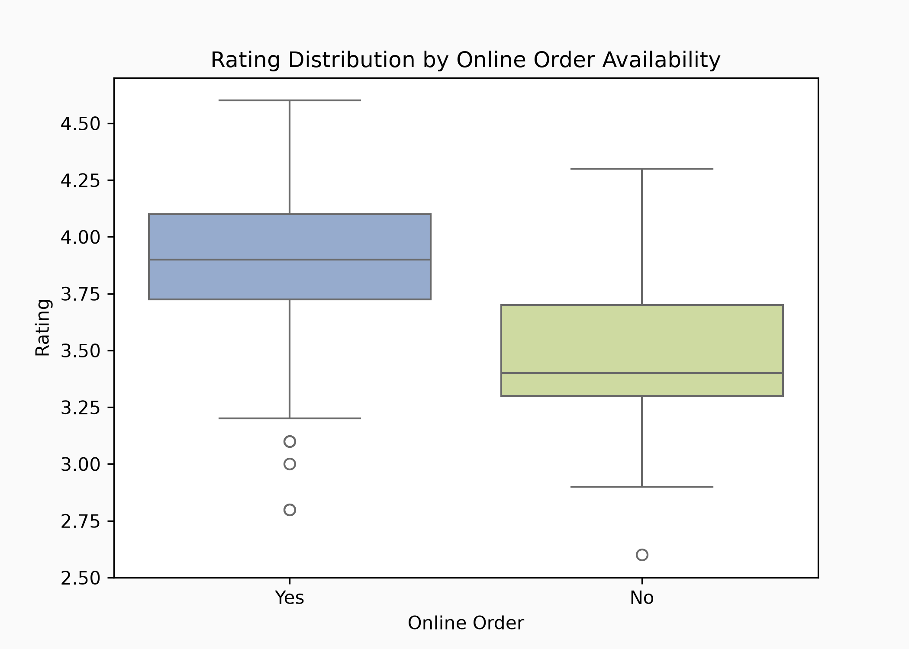
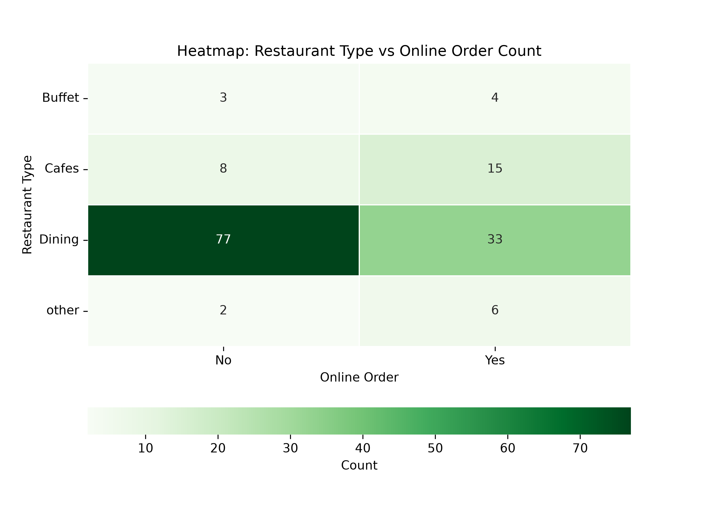

# 🍽️ Zomato Restaurant Data Analysis & Visualization

An exploratory data analysis (EDA) project investigating restaurant performance, customer engagement (votes/ratings), and online ordering habits using Python, Pandas, Matplotlib, and Seaborn.

---

## 📌 Project Overview
The goal of this analysis is to extract meaningful business insights from Zomato restaurant listings, identifying key factors that contribute to high ratings, order volume, and customer voting engagement.

### 🔑 Key Findings
- **Most Popular Categories**: Casual dining and quick bites dominate total listings and aggregate votes.
- **Online Ordering Impact**: Restaurants supporting online ordering generally maintain higher rating density and engagement than those without online delivery.
- **Rating Distribution**: Most rated restaurants sit between 3.5 and 4.2 stars, showing a slight positive skew.

---

## 📊 Visual Insights

| Ratings vs Online Delivery | Restaurant Types vs Online Orders |
| :---: | :---: |
|  |  |

---

## 🛠️ Tech Stack
- **Language**: Python 3.x
- **Data Manipulation**: Pandas, NumPy
- **Data Visualization**: Matplotlib, Seaborn

---

## 🚀 How to Run Locally

1. **Clone the repository**:
   ```bash
   git clone [https://github.com/your-username/zomato-restaurant-analysis.git](https://github.com/your-username/zomato-restaurant-analysis.git)
   cd zomato-restaurant-analysis